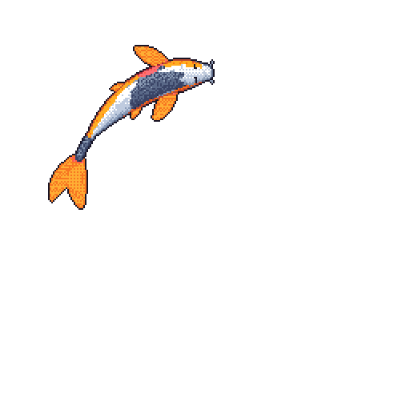

<table>
  <tr>
    <td valign="middle">
      <h2>Product Engineer. Built in production.</h2>
      
Four years in 24/7 production support for a global betting platform taught me what happens when software breaks at 2am with real money on the line. Now I build the software: design systems and Angular/TypeScript frontends, API and payment integrations, and my own AI app with paying customers. I design for the person who has to fix it as well as the one who uses it.

    </td>
    <td align="right" valign="middle">
      
    </td>
  </tr>
</table>
